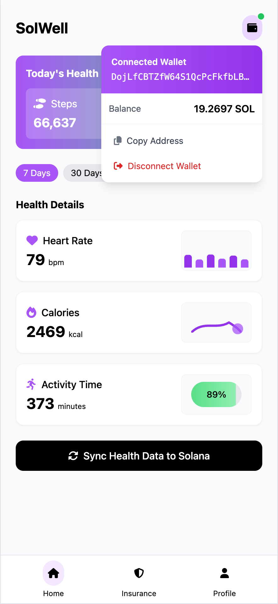
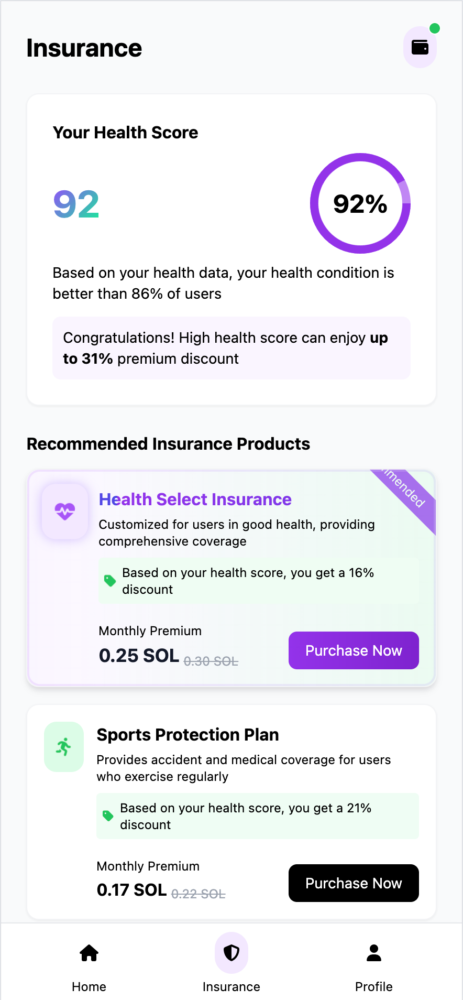
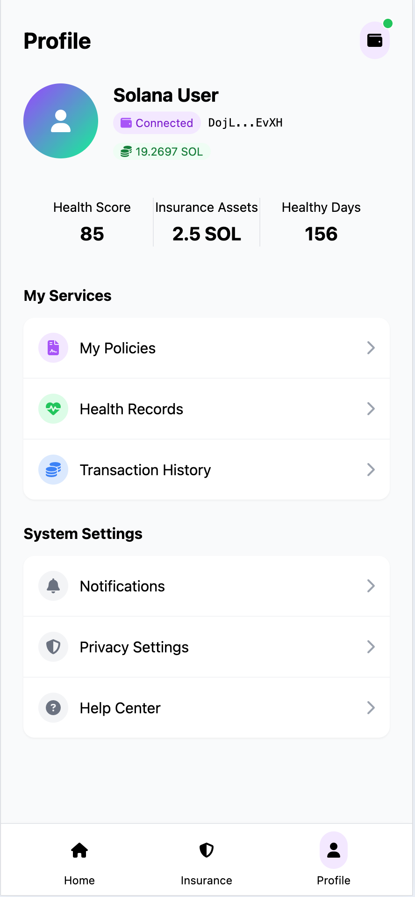

# SolWell

English | [简体中文](README.zh-CN.md)

SolWell is a Solana-based health management and insurance DApp prototype. You can connect a Phantom wallet, view health metrics such as steps, sleep, and heart rate, sync demo data on-chain, and see insurance products and premium discounts based on a health score.

The project is currently focused on testing the UI and on-chain data flow. It is not ready for real insurance use.

## What's implemented

- **Health dashboard**: Displays steps, sleep duration, heart rate, calories, and activity time, with filters for 7 days, 30 days, 365 days, and all time.
- **Wallet connection**: Integrates Phantom for connecting, disconnecting, viewing balances, and copying addresses. Deep links and a QR code entry point are available for opening the app in Phantom on mobile.
- **Health data sync**: After confirmation, requests a wallet signature and attempts to write daily, weekly, monthly, yearly, and all-time data to Solana.
- **Insurance page**: Calculates a health score on the frontend and displays recommended products and discounts. The product list uses mock data and is not connected to an on-chain purchase flow.
- **Profile page**: Shows wallet information and personal service entries. Statistics such as health score, insurance assets, and healthy days are static demo values, and some menu items are UI-only.
- **Insurance product program**: Supports initializing an administrator account, creating insurance products, and letting product creators update product details and active status.

## Tech stack

The frontend uses Next.js 14, React 18, and Tailwind CSS 3. Wallet and blockchain interactions use `@solana/web3.js` and `@coral-xyz/anchor`. Both Solana programs are written in Rust with Anchor, with tests in TypeScript.

## Project structure

```text
.
├── SolWell- frontend/       # Next.js frontend (the directory name contains a space)
│   └── app/
│       ├── components/      # Wallet dialogs, sync confirmation, bottom navigation, etc.
│       ├── contexts/        # Wallet state and health data reads/writes
│       ├── insurance/       # Insurance recommendations page
│       ├── profile/         # Profile page
│       └── health_data.json # Health data program IDL used by the frontend
├── sol-well-contracts/      # Health data program and tests
├── insurance-contract/      # Insurance product management program and tests
└── screenshots/             # App screenshots
```

## Screenshots

These screenshots show the health dashboard, wallet menu, profile, and insurance recommendations. The metrics, scores, and insurance prices illustrate the interface; they are not real health records or insurance business data.

| Health dashboard | Wallet menu |
| --- | --- |
|  |  |

| Profile | Insurance recommendations |
| --- | --- |
|  |  |

## Run the frontend locally

Install Node.js 18.17 or later and npm. To try wallet interactions, also install Phantom and switch it to **Devnet**.

From the project root:

```bash
cd "SolWell- frontend"
npm install
npm run dev
```

Open <http://localhost:3000>. The frontend connects to Solana Devnet by default. The network is configured in `app/contexts/WalletContext.js`; no additional environment variables are currently required.

Other commands:

```bash
npm run build  # Build the frontend
npm run start  # Run the production build
```

You can browse the demo without connecting a wallet. To connect and try syncing data, you will need a small amount of Devnet SOL for transaction fees and account rent.

## Contract development

Install Rust, the Solana CLI, the Anchor CLI, and Yarn, and set up a local Solana wallet first. The two programs are separate Anchor workspaces, so install dependencies and build each one separately.

```bash
# Health data program
cd sol-well-contracts
yarn install
anchor build
anchor test

# Insurance product program
cd ../insurance-contract
yarn install
anchor build
anchor test
```

Both workspaces default to `localnet` in `Anchor.toml`, with the wallet at `~/.config/solana/id.json`. The frontend uses Devnet, so running the programs locally does not automatically switch the frontend network.

Program addresses declared in the current source:

| Program | Address |
| --- | --- |
| Health data | `ESrVTzUZSTro7K5j3eibWLX4mzxPHN2JHnNW4gCSidUr` |
| Insurance products | `J6pC1jbqJFSAfai5ociJQzCUg6uspv62FcnRNV7R1stE` |

When deploying your own programs, check the program addresses against the deployment keypairs and keep `declare_id!`, `Anchor.toml`, the generated IDLs, and the frontend configuration in sync. The health data tests use the `HealthData` workspace name, while the insurance source uses the module name `insurance`; these do not exactly match the directory names. Before running the tests, also check that the generated IDLs, type files, and test references match. The commands above describe the development workflow, not a claim that the current version has passed builds and tests.

### Health data storage

Health data accounts use PDAs derived from these seeds:

```text
["health_info", user public key, time range]
```

The supported time ranges are `Day`, `Week`, `Month`, `Year`, and `All`. Each account stores its user, time range, steps, sleep duration, heart rate, calories, and active minutes. Data for the same user and time range is updated in place rather than appended as a daily history.

### Insurance product management

The insurance program stores a product ID, name, description, coverage amount, premium, coverage duration in days, and active status. It currently only provides product management instructions. There is no premium payment, policy issuance, claims processing, or automatic billing, and the frontend insurance page is not yet connected to this program.

## Things to know before using it

- No wearables, mobile health platforms, or other real health data sources are connected. Syncing generates demo data for each time range; it should not be treated as collected health records.
- Failed on-chain health data reads fall back to mock data. Failed balance reads may also display a mock balance.
- If a sync transaction fails, the code returns a simulated success result with `simulated: true` and a transaction ID starting with `simulated_`. A success message in the UI does not mean a transaction was recorded on-chain. Check the actual result in a Devnet explorer.
- Health scores, rankings, and discounts are for demonstration only. They are neither medical assessments nor official insurance quotes.
- Health metrics are stored directly in on-chain accounts, without an encryption or access-control scheme. Use a test wallet and fictional data. Do not upload real personal health information or use mainnet funds.
