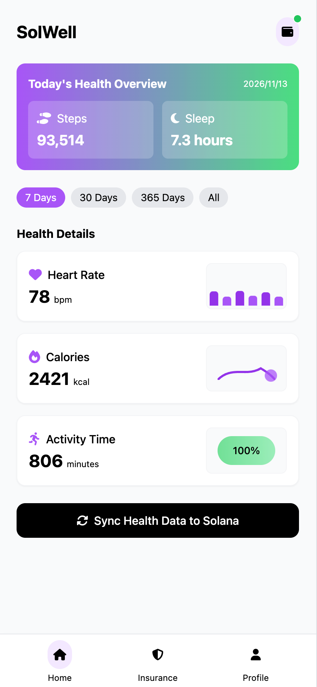

# SolWell

SolWell 是一个基于 Solana 的健康管理和保险 DApp 原型。可以连接 Phantom 钱包，查看步数、睡眠、心率等健康指标，把演示数据同步到链上，再根据健康评分展示保险产品和保费折扣。

项目目前主要用于验证页面交互和链上数据读写，还不是可以直接用于真实保险业务的产品。

## 目前做了什么

- **健康首页**：展示步数、睡眠时长、心率、卡路里和活动时间，支持切换 7 天、30 天、365 天和全部时间。
- **钱包连接**：接入 Phantom，支持连接、断开、查看余额和复制地址；移动端提供 Phantom 深层链接和二维码入口。
- **健康数据同步**：确认后请求钱包签名，尝试将日、周、月、年及全部时间的数据写入 Solana。
- **保险页面**：在前端计算健康评分，展示推荐保险和折扣。目前产品列表使用模拟数据，没有接入链上投保流程。
- **个人页面**：展示钱包信息及个人服务入口。健康评分、保险资产和健康天数等统计目前是静态演示值，部分菜单仅做了界面。
- **保险产品合约**：支持初始化管理员账户、创建保险产品，以及由产品创建者更新产品信息和启用状态。

## 技术栈

前端使用 Next.js 14、React 18 和 Tailwind CSS 3，钱包与链上交互使用 `@solana/web3.js` 和 `@coral-xyz/anchor`。两个 Solana 程序均使用 Rust 和 Anchor 编写，测试使用 TypeScript。

## 目录结构

```text
.
├── SolWell- frontend/       # Next.js 前端（目录名中有空格）
│   └── app/
│       ├── components/      # 钱包弹窗、同步确认、底部导航等组件
│       ├── contexts/        # 钱包状态和健康数据读写
│       ├── insurance/       # 保险推荐页面
│       ├── profile/         # 个人页面
│       └── health_data.json # 前端使用的健康数据程序 IDL
├── sol-well-contracts/      # 健康数据程序及测试
├── insurance-contract/      # 保险产品管理程序及测试
└── screenshots/             # 项目界面截图
```

## 界面截图

下面是健康首页、钱包菜单、个人页面和保险推荐页面。截图中的指标、评分和保险价格用于展示页面效果，不代表真实健康或保险业务数据。

| 健康首页 | 钱包菜单 |
| --- | --- |
|  |  |

| 个人页面 | 保险推荐 |
| --- | --- |
|  |  |

## 本地启动前端

准备 Node.js 18.17 或更高版本，以及 npm。需要体验钱包交互时，再安装 Phantom，并切换到 **Devnet**。

在项目根目录执行：

```bash
cd "SolWell- frontend"
npm install
npm run dev
```

打开 <http://localhost:3000>。前端默认连接 Solana Devnet，网络地址写在 `app/contexts/WalletContext.js` 中，当前不需要额外配置环境变量。

其他命令：

```bash
npm run build  # 构建前端
npm run start  # 运行构建后的应用
```

未连接钱包也能查看演示界面。连接钱包并尝试同步时，需要准备少量 Devnet SOL 支付交易费和账户租金。

## 合约开发

需要先安装 Rust、Solana CLI、Anchor CLI 和 Yarn，并准备本地 Solana 钱包。两个合约是独立的 Anchor 工作区，需要分别安装依赖和构建。

```bash
# 健康数据程序
cd sol-well-contracts
yarn install
anchor build
anchor test

# 保险产品程序
cd ../insurance-contract
yarn install
anchor build
anchor test
```

两个工作区的 `Anchor.toml` 默认使用 `localnet`，钱包路径是 `~/.config/solana/id.json`；前端则使用 Devnet，启动本地合约不会自动切换前端网络。

当前源码声明的程序地址：

| 程序 | 地址 |
| --- | --- |
| 健康数据 | `ESrVTzUZSTro7K5j3eibWLX4mzxPHN2JHnNW4gCSidUr` |
| 保险产品 | `J6pC1jbqJFSAfai5ociJQzCUg6uspv62FcnRNV7R1stE` |

自行部署时，需要核对部署密钥对应的程序地址，保持 `declare_id!`、`Anchor.toml`、生成的 IDL 和前端配置一致。健康数据测试使用 `HealthData` 工作区名称，保险源码中的模块名是 `insurance`，与目录名并不完全相同；运行前也要检查生成的 IDL、类型文件和测试引用是否匹配。以上是开发命令，不代表当前版本已经通过构建和测试。

### 健康数据存储

健康数据账户使用以下种子派生 PDA：

```text
["health_info", 用户公钥, 时间范围]
```

时间范围包括 `Day`、`Week`、`Month`、`Year` 和 `All`。账户保存所属用户、时间范围、步数、睡眠时长、心率、卡路里和活动分钟数，同一用户同一范围的数据会被更新，不是逐日追加的历史记录。

### 保险产品管理

保险合约保存产品编号、名称、描述、保额、保费、保障天数和启用状态。当前只有产品管理指令，没有投保付款、出单、理赔或自动扣费功能，前端保险页面也尚未接入这个合约。

## 使用前需要知道

- 尚未接入手环、手机健康平台或其他真实健康数据源。同步时会生成各时间范围的演示数据，不应把它当成真实采集记录。
- 读取链上健康数据失败时会返回模拟数据；余额读取失败时也可能显示模拟余额。
- 同步交易失败时，代码会返回带有 `simulated: true` 的模拟成功结果，交易编号以 `simulated_` 开头。页面显示成功不等于交易真的上链，实际结果要到 Devnet 浏览器核对。
- 健康评分、排名和折扣仅用于演示，不是医学判断，也不是保险公司的正式报价。
- 健康指标直接保存在链上账户中，目前没有加密或访问控制方案。请使用测试钱包和虚构数据，不要上传真实个人健康信息，也不要使用主网资金。
